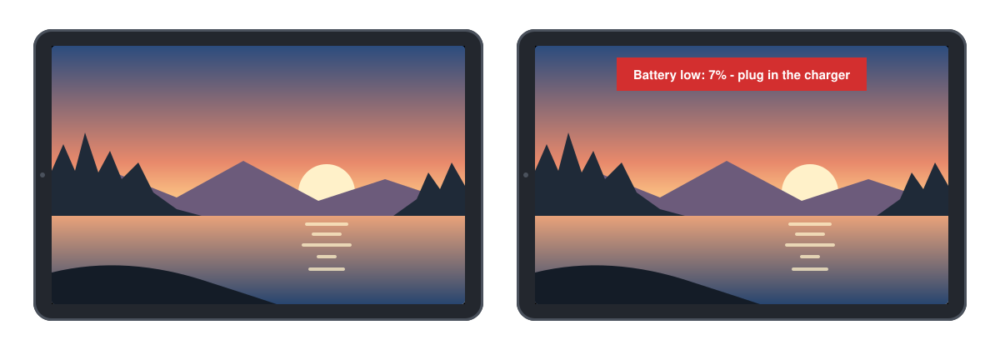

# Flipphot

**Turn an old Android tablet into a photo frame. No internet, no ads, no accounts. 17 KB.**

<p align="center">
  
</p>

<p align="center">
  <a href="https://github.com/racasan/flipphot/releases/latest"><b>Download the APK</b></a>
  &nbsp;·&nbsp; Android 7.0 and newer &nbsp;·&nbsp; <a href="LICENSE">MIT license</a>
</p>

## Why

I wanted to use an old Huawei MediaPad T3 10 as a photo frame. The apps I found
wanted an internet connection, an account, or a subscription, and felt heavy on
a tablet from 2017. Flipphot does one thing: it shows the photos already on the
tablet, full screen, and stays out of the way.

## At a glance

| | |
|---|---|
| **APK size** | 17 KB |
| **Permissions** | 1 (read photos) |
| **Internet access** | none: the app cannot go online |
| **Third-party libraries** | 0 |
| **Memory in use** | about 40 MB |
| **CPU between slides** | 0% |

Memory and CPU were measured on the MediaPad T3 10.

## Features

- Full-screen, cross-fading slideshow of the photos on the device (internal storage and SD card)
- Show everything, or pick one folder (album)
- Shuffle or oldest-first order
- Time per photo from 5 seconds to 1 hour
- A red on-screen warning when the battery drops below 10% and the charger is unplugged
- Keeps the screen on while the app is open
- No audio, ever

## Install

1. Download `flipphot-1.0.apk` from the [latest release](https://github.com/racasan/flipphot/releases/latest) onto the tablet.
2. Open it. Android will ask you to allow installing apps from unknown sources.
3. Start Flipphot and allow it to read your photos.

The APK is signed with a debug key, so Android may show a warning during install.

## Using it

Tap the screen to show the controls: **Previous**, **Pause**, **Next**, and **Settings**.
They hide again after a few seconds.

Flipphot shows whatever the tablet's own Gallery app can see. If photos you
just copied over are missing, restart the tablet so it re-indexes them.

## How it stays light

- Each photo is scaled down to screen size before it is shown, so a 12-megapixel
  picture costs a few MB of memory instead of about 48 MB
- At most two photos are held in memory, and only during a cross-fade
- Nothing runs between slides except a single timer
- It is plain Android framework code in [one Java file](app/src/main/java/com/flipphot/MainActivity.java)

## Build it yourself

You need the Android SDK (platform 36) and JDK 17 or newer.

```bash
./gradlew assembleRelease
```

The APK is written to `app/build/outputs/apk/release/app-release.apk`. Install it over USB with:

```bash
adb install -r app/build/outputs/apk/release/app-release.apk
```

## License

[MIT](LICENSE)
